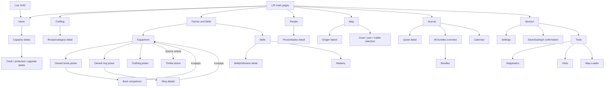

# Menu page map — design gate

Every page/state must have a reviewed 320x240 mockup, entry/back controls, empty/error/locked states, asset/RAM plan and source behavior before implementation. A route entry alone is not approval to code it.

All routes below are proposals. Rendered does not mean approved or implemented.

B returns to the listed parent, preserving cursor/scroll. L/R on a child leaves to the next main page in its owning bank; unfinished changes are canceled. Opening a picker/compare is read-only; only explicit equip commits. No world/save changes occur in this gallery.

| Page / state | Open from | Back destination | Design status |
| --- | --- | --- | --- |
| Items + Backpack | START / Items tab | Live HUD | [Mockup](01-items.png), review pending |
| Item details | Select an item + A | Items + Backpack | **Needs mockup — blocked** |
| Move/stack state | X on an item | Items + Backpack | **Needs mockup — blocked** |
| Split stack | Quantity action in item details | Items + Backpack | **Needs mockup — blocked** |
| Farmer equipment | Farmer button in hub | Farmer & Skills | [Mockup](equipment.png), review pending |
| Choose boots | Select Boots + A | Farmer equipment | [Mockup](equipment-boots-picker.png), review pending |
| Compare boots | Choose Space Boots + A | Choose boots | [Mockup](equipment-boots-compare.png), review pending |
| After boot swap (state) | Confirm equip in comparison | Farmer & Skills | [Mockup](equipment-after-swap.png), review pending |
| Choose ring 1 | Select Ring 1 + A | Farmer equipment | [Mockup](equipment-rings-picker.png), review pending |
| Choose ring 2 | Select Ring 2 + A | Farmer equipment | **Needs mockup — blocked** |
| Ring item details | Choose Glow Ring + A | Choose ring 1 | [Mockup](equipment-ring-detail.png), review pending |
| Hat/shirt/pants picker | Select corresponding clothing slot + A | Farmer equipment | **Needs mockup — blocked** |
| Trinket unlocked (state) | Progression enables source trinketSlots | Farmer & Skills | [Mockup](equipment-trinket-unlocked.png), review pending |
| Choose trinket | Select unlocked trinket + A | Trinket unlocked (state) | **Needs mockup — blocked** |
| Equipment failure/empty states | Unequip into full bag / no compatible items | Farmer equipment | **Needs mockup — blocked** |
| Crafting | Crafting tab | Live HUD | [Mockup](02-crafting.png), review pending |
| Recipe category picker | X: category | Crafting | **Needs mockup — blocked** |
| Full recipe/ingredients | A: recipe | Crafting | **Needs mockup — blocked** |
| Craft quantity | Choose craft quantity | Full recipe/ingredients | **Needs mockup — blocked** |
| Farmer & Skills | Farmer tab | Live HUD | [Mockup](03-skills.png), review pending |
| Skill/profession detail | Select a skill + A | Skills levels | **Needs mockup — blocked** |
| Profession choice | Source level/progression condition | Skill/profession detail | **Needs mockup — blocked** |
| People | People tab | Live HUD | [Mockup](04-people.png), review pending |
| Person details | Select person + A | People | [Mockup](person-detail.png), review pending |
| Known gift tastes | View tastes | Person details | [Mockup](gift-log.png), review pending |
| Map | Map tab / map shortcut | Live HUD | [Mockup](05-map.png), review pending |
| Zoom/pan state | X/+ from overview | Map | [Mockup](map-valley-zoom.png), review pending |
| Location details | Optional future detail action | Map | **Needs mockup — blocked** |
| Journal | Journal tab | Live HUD | [Mockup](06-journal.png), review pending |
| Quest details | Select ready Getting Started entry | Journal | [Mockup](quest-ready.png), review pending |
| Quest action confirmation | Claim/cancel when source permits | Quest details | **Needs mockup — blocked** |
| Bundle detail | Select Spring Foraging in catalog | Room/bundle selection | [Mockup](08-bundles.png), review pending |
| Room/bundle selection | X: bundles from Journal | Journal | [Mockup](bundles-overview.png), review pending |
| Donation item selection | Select ingredient slot + A | Bundle detail | **Needs mockup — blocked** |
| Calendar | Proposed Journal date/calendar action | Journal | **Needs mockup — blocked** |
| Day/event detail | Select a day + A | Calendar | **Needs mockup — blocked** |
| Session | Session tab | Live HUD | [Mockup](07-session.png), review pending |
| Load confirmation | Load game | Session | **Needs mockup — blocked** |
| Settings categories | Settings | Session | **Needs mockup — blocked** |
| Controls settings | Controls | Settings categories | **Needs mockup — blocked** |
| Audio settings | Audio | Settings categories | **Needs mockup — blocked** |
| Display settings | Display | Settings categories | **Needs mockup — blocked** |
| Quit confirmation | Quit... | Session | **Needs mockup — blocked** |
| Save/failure status | Save game / save and quit | Session | **Needs mockup — blocked** |
| Tools: Diagnostics | Developer tools | Session | [Mockup](tools-01-diagnostics.png), review pending |
| Tools: Visit People | Tool tab / L/R | Session | [Mockup](tools-02-visits.png), review pending |
| Tools: Preview time | X: preview time | Tools: Visit People | **Needs mockup — blocked** |
| Tools: Map Loader | Tool tab / L/R | Session | [Mockup](tools-03-map-loader.png), review pending |
| Tools: Map filter | X: filter | Tools: Map Loader | **Needs mockup — blocked** |
| Backpack | Capacity comparison state; no separate main tab | Items + Backpack | [Mockup](backpack.png), review pending |
| 12-slot backpack state | Before first upgrade | Backpack | [Mockup](backpack-12.png), review pending |
| 36-slot backpack state | After second upgrade | Backpack | [Mockup](backpack-36.png), review pending |
| Backpack upgrade information | Select a locked row | Backpack | [Mockup](backpack-upgrade-info.png), review pending |
| Trash confirmation | Tap trash / Y on eligible selected item | Backpack | [Mockup](trash-confirm.png), review pending |
| Protected item state | Attempt to trash protected item | Backpack | [Mockup](trash-locked.png), review pending |
| Skills at level 10 (state) | Source skill progression | Skills levels | [Mockup](skills-maxed.png), review pending |
| Mastery overview | X from unlocked Skills levels | Skills levels | [Mockup](mastery.png), review pending |
| Mastery locked state | X from locked Skills levels | Skills levels | [Mockup](mastery-locked.png), review pending |
| People with official tracking | Same official tracking as main People page | People | [Mockup](people-official.png), review pending |
| Current location unavailable | No current-location value | People | [Mockup](person-location-unknown.png), review pending |
| Robin profile variation | Select Robin + A | People | **Needs mockup — blocked** |
| Ginger Island overview | SELECT/tap region title after access | Map | [Mockup](map-island.png), review pending |
| Ginger Island zoomed state | X/+ from Island overview | Ginger Island overview | [Mockup](map-island-zoom.png), review pending |
| Ginger Island unavailable | SELECT/tap region before progression | Map | [Mockup](map-island-locked.png), review pending |
| Active quest detail variation | Select unfinished quest | Journal | **Needs mockup — blocked** |
| Journal after collection (state) | Collect quest reward | Journal | [Mockup](journal-after-claim.png), review pending |
| Pantry catalog view | Filter/scroll bundle overview | Room/bundle selection | [Mockup](bundles-pantry.png), review pending |
| Fish Tank catalog view | Filter/scroll bundle overview | Room/bundle selection | [Mockup](bundles-fish-tank.png), review pending |
| Boiler Room catalog view | Filter/scroll bundle overview | Room/bundle selection | [Mockup](bundles-boiler-room.png), review pending |
| Bulletin Board catalog view | Filter/scroll bundle overview | Room/bundle selection | [Mockup](bundles-bulletin-board.png), review pending |
| Vault catalog view | Filter/scroll bundle overview | Room/bundle selection | [Mockup](bundles-vault.png), review pending |
| Abandoned Joja Mart catalog view | Filter/scroll bundle overview | Room/bundle selection | [Mockup](bundles-abandoned-joja-mart.png), review pending |
| Skills levels | Skills button in hub | Farmer & Skills | [Mockup](skill-levels.png), review pending |
| Trash can upgrade reference | Design comparison; upgrades are bought at blacksmith | Items + Backpack | [Mockup](trash-upgrades.png), review pending |
| Inventory trash tier 0 | Comparison state | Items + Backpack | [Mockup](inventory-trash-0.png), review pending |
| Inventory trash tier 1 | Comparison state | Items + Backpack | [Mockup](inventory-trash-1.png), review pending |
| Inventory trash tier 2 | Comparison state | Items + Backpack | [Mockup](inventory-trash-2.png), review pending |
| Inventory trash tier 3 | Comparison state | Items + Backpack | [Mockup](inventory-trash-3.png), review pending |
| Inventory trash tier 4 | Comparison state | Items + Backpack | [Mockup](inventory-trash-4.png), review pending |
| Copper trash confirmation | Sample upgraded can | Trash confirmation | [Mockup](trash-confirm-copper.png), review pending |
| Steel trash confirmation | Sample upgraded can | Trash confirmation | [Mockup](trash-confirm-steel.png), review pending |
| Gold trash confirmation | Sample upgraded can | Trash confirmation | [Mockup](trash-confirm-gold.png), review pending |
| Iridium trash confirmation | Sample upgraded can | Trash confirmation | [Mockup](trash-confirm-iridium.png), review pending |
| Birthday not yet learned | Proposed discovery state | People | [Mockup](person-birthday-unknown.png), review pending |
| 16px tab comparison | Design size comparison | Items + Backpack | [Mockup](tabs-16.png), review pending |
| 28px tab comparison | Design size comparison | Items + Backpack | [Mockup](tabs-28.png), review pending |
| 32px tab comparison | Design size comparison | Items + Backpack | [Mockup](tabs-32.png), review pending |
| Top L/R reference alternative | Compare navigation placement | Items + Backpack | [Mockup](items-top-nav.png), review pending |

## Equipment rules

- Decomp slots: Hat, Shirt, Pants, Boots, Left Ring, Right Ring; trinket only when the source progression flag enables it. Clothes do not invent body armor.
- Boots comparison uses source Boots.json defense/immunity. Rings show original effect descriptions; both ring targets must be explicit.
- The three clothing categories share a filtered picker structure but their labels/icons/empty states require review.
- Preserve all unrelated gear and inventory; no automatic item drops when a replacement/unequip cannot be stored.
- Existing bag/ring/boot/progression data shown here is sample UI data; these systems are not added to the port.

## Reserved future scope

Collections, Animals and Powers are original-game concepts reserved for later planning. They are not in this seven-page proposal yet. Each needs its own page map, mockups and user review before adding it.

## Tab geometry

The visible wood rail starts at y=230. Original 16px art is now drawn at 1x (16px) in y=214..229, keeping its flat bottom on the rail. Seven root tabs start at x=80 with a 24px pitch; 24px L/R frames use the blank tab rotated open toward the left/right outer edges. No wrapper box, selection outline or separator is added. Breadcrumbs containing > are centered and raised to y=35. Bigger draw geometry does not require bigger source textures.

## Social parity decision

Two 64x64 portraits are shown. User chose the official two weekly gift checkboxes and one daily-talk flag; no 0/2 talk counter. Details now show current location using the source display name, not home metadata. Birthday discovery is proposed: known/??? examples are rendered; original ProfileMenu does not require learning a birthday. Gift tastes remain discovered-only.

## Revision 4 controls

Items merges hotbar/backpack with tinted hotbar and no row labels. Farmer & Skills is a two-button hub; equipment returns there. Trash artwork/body/lid and tool upgrades use one source level, with 0/15/30/45/60% eligible-item reclamation. X/+ zooms in, Y/- zooms out. SELECT (S in browser) or tap region title changes accessible map region. Journal reward icons may vary by reward type.

Revision 5 uses 16px draws of the preserved user-edited 18px prompt inputs. Trinket stats are below equipment and leave the breadcrumb band clear. Inventory hotbar paper is darker and upgrade badge text is 2px lower. See scale-pages.png for 16/24/28/32px tabs and small top-L/R alternative.

Current revision 6: 16px tabs selected. L/R retain 24px geometry and bottom placement, but use the source open-bottom tab rotated clockwise for L and counterclockwise for R. Trinket slot is at (145,147), stats split left/right at y=163, farmer frame 76x74 with an integer 2x farmer (32x64). Earlier scale examples remain references.

2026-10-30 spacing follow-up: L/R frames, lettering and touch targets moved outward 1px to x=11/x=285. Crafting requirement frame/text moved up 4px (frame y=147, height=20) to clear its containing item frame.

Latest corner follow-up: L/R moved one further pixel outward to x=10/x=286. The bottom of each side tab is open into the panel rail, with its inner border bending into the bottom frame. Prompt row moved down 6px to y=184; glyphs y=186..201, leaving space above the 16px tabs. Corner extensions are decorative; 24px button targets track the shifted frames.

Corner correction: user requires a right angle. The stepped/inward bend is superseded by a straight vertical border meeting the horizontal outer bottom rail at 90 degrees. No corner extension or bevel; frame geometry/targets stay 24px.

Current tabs are 32px wide by 24px high, x=36, pitch=36, y=206..229. Page tab artwork stretches 2x horizontally, 1.5x vertically. L/R artwork, lettering, right-angle joins and targets remain unchanged. Separate width and height define tab hits; square scale examples remain references.

Latest navigation spacing: only L/R frames, upright letters and targets moved outward 2px to x=8/x=288. This gives 4px gaps to the first/last 32x24 page tabs, matching the 4px gaps between page tabs. Page-tab art, positions, content and prompt row unchanged.
